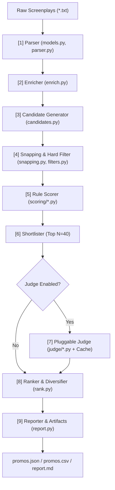

# Promo Finder: System Architecture & Implementation Blueprint

## 1. Overview & Business Objective
- **Problem**: Editors manually scrub 50+ microdrama episodes weekly looking for 20-60s teaser clips for TikTok/Instagram/YouTube Shorts.
- **Goal**: An automated, deterministic, local-first CLI tool (`promofinder`) that parses 50 episodic screenplay `.txt` files, generates valid candidates, scores hooks and cliffhangers, applies filters/deduplication, and outputs ranked promo clips with explanations.
- **Key Constraints**:
  - Pure Python / local rules first (`--judge none` must run in < 30s with zero cost/internet).
  - Pluggable judge layer for optional LLM re-scoring.
  - Strict compliance with ReelShort / DramaBox promo psychology:
    1. **Hook (0-3s)**: High emotion, confrontation, slap/action shock, question/accusation.
    2. **Cliffhanger (final 5s)**: Unresolved question, threat, ultimatum, reaction cut.
    3. **Clarity**: Standalone comprehension without series backstory.
    4. **No Spoilers**: Cap late-episode revelation moments.

---

## 2. Dataset Analysis (Verified on Disk)
- **Folder**: `I Married a Broken Soldier. He was a Duke-script/I Married a Broken Soldier. He was a Duke`
- **Episodes**: Exactly 50 files (`episode-001-...txt` to `episode-050-...txt`).
- **Structure Observed**:
  - Metadata block (`EPISODE NUMBER`, `EPISODE LOGLINE`, `CONTINUITY NOTES`).
  - Separator `--- SCRIPT START ---`.
  - Scene boundaries (`SCENE 01`, `Scene start`, `Scene end`).
  - Content blocks:
    - `**CAMERA:**` with `Start: (MM:SS.cc) | End: (MM:SS.cc)`
    - `**ACTION:**` with `Start: (MM:SS.cc) | End: (MM:SS.cc)`
    - `**SPEAKER (Emotion, Tag):**` with dialogue text in quotes.
- **Timing syntax**: `(MM:SS.cc)` -> float seconds conversion: `min * 60 + sec + cc / 100.0`.

---

## 3. High-Level Design (HLD)

### 3.1 Pipeline Flow

### 3.2 Pipeline Stages & Invariants
1. **Parser (`parser.py`)**:
   - Parses scenes, camera shots, actions, and dialogue blocks with emotions.
   - Fault-tolerant: skips malformed blocks with warnings, never crashes.
2. **Enricher (`enrich.py`)**:
   - Computes emotion intensity from tag lexicons.
   - Builds sliding window shot rate and tension curve `tension(t)`.
   - Character alias suggestions (e.g. `MATRIARCH`, `LADY JULIANA`).
3. **Candidate Generator (`candidates.py`)**:
   - `SINGLE`: 20-60s window anchored on dialogue/action start.
   - `EP_END`: Window forced to episode finale.
   - `STITCH`: Setup (6-15s premise, eps 1-3) + Payoff (15-45s confrontation).
4. **Snapping & Hard Filtering (`snapping.py`, `filters.py`)**:
   - Snaps start backward to preceding camera cut or line start (`lead_in = 0.25s`).
   - Snaps end forward to include reaction shot or sound stinger (`tail = 0.4s`).
   - Rejects: length `< 20s` or `> 60s`, cold mid-sentence starts, cut mid-line ends, dead starts, resolution words, spoiler episodes.
5. **Rule Scoring (`scoring/`)**:
   - Hook score ($w=0.30$), Cliffhanger score ($w=0.30$), Clarity ($w=0.15$), Intensity ($w=0.10$), Duration fit ($w=0.05$), Spoiler risk ($-0.10$).
   - Gates: Drop candidates with hook $< 0.35$ or cliffhanger $< 0.35$.
6. **Ranking & Diversification (`rank.py`)**:
   - Temporal IoU deduplication (max 20% overlap).
   - Episode diversity (max 2 per episode, at least 3 distinct episodes in top 10).
   - Near-duplicate penalty via text Jaccard similarity.
   - Tiers: `POST_FIRST` (Rank 1-5), `STRONG` (Rank 6-15), `BACKUP` (Rank 16-20).
7. **Reporting & Evaluation (`report.py`, `evaluate.py`)**:
   - `promos.json`, `promos.csv`, `report.md`, and execution diagnostics.

---

## 4. Execution Plan (Milestones)

- **Milestone 1**: Project bootstrap (`pyproject.toml` / dependencies or pure stdlib fallbacks), Data models (`models.py`), Parser (`parser.py`) & validation against all 50 episodes.
- **Milestone 2**: Lexicons (`hook_words.yaml`, `cliff_words.yaml`, etc.), Enrichment (`enrich.py`), Snapping (`snapping.py`), and Candidate Generator (`candidates.py`).
- **Milestone 3**: Rule Scorer (`scoring/*.py`), Hard-rule Filters (`filters.py`), and Ranker (`rank.py`). Run `--judge none` on full 50 episodes.
- **Milestone 4**: Gold promo dataset (`gold_promos.json`), Evaluator (`evaluate.py`), and Failure Analysis report ("Where the tool picks badly").
- **Milestone 5**: Optional Judge integration (`judge/`) with prompt rubric & local caching.
- **Milestone 6**: Stitching engine (cross-scene/episode promos) & Alias discovery.
- **Milestone 7**: Clean CLI interface, documentation, and executive summary.
