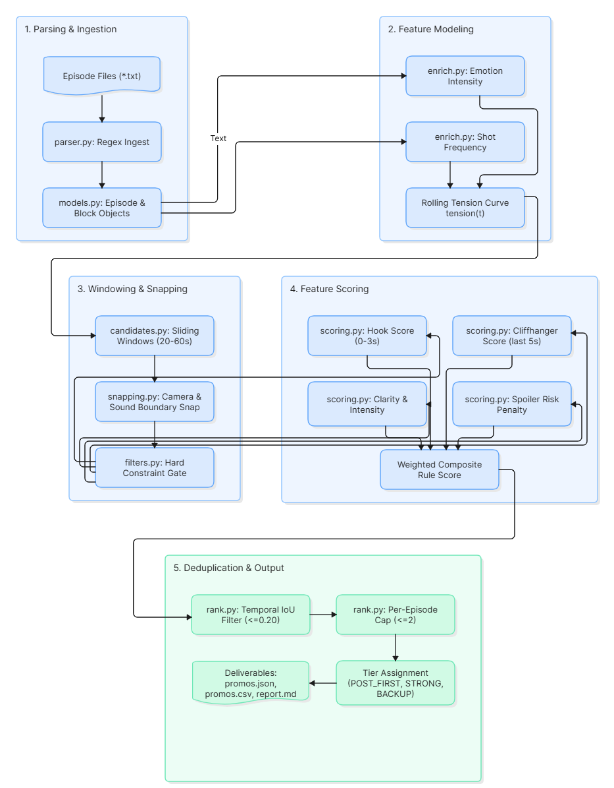

# PromoFinder: Intelligent Microdrama Promo Selection Engine

[](https://sandeep1-prog.github.io/KUKU_project/)
[](https://www.python.org/)
[](https://github.com/Sandeep1-prog/KUKU_project)

An automated, local-first intelligence engine designed to parse microdrama episodic screenplays, quantify dramatic tension, snap cut boundaries to cinematic transitions, and discover 20–60 second high-conversion promotional moments (hooks and cliffhangers) for short-form video distribution (TikTok, Instagram Reels, YouTube Shorts).

Tested and validated on **50 full episodes** (3,727 script blocks, 1,487 dialogue lines) in **4.61 seconds** on CPU.

---

## 🏛 System Architecture



The engine operates across five modular processing stages:
1. **Screenplay Parsing (`parser.py`):** Ingests structured episodic text, extracting scene boundaries, camera movements, physical actions, and dialogue lines with centisecond-precision timestamps.
2. **Emotional & Tension Modeling (`enrich.py`):** Derives scalar emotional intensity from dialogue cues ($I(l) = 0.8 \max(E) + 0.2 \operatorname{mean}(E)$) and models rolling temporal tension curves $T(t)$ across shot frequencies and punctuation density.
3. **Candidate Generation & Boundary Snapping (`candidates.py`, `snapping.py`):** Generates legal 20–60s windows anchored on narrative beats. Automatically snaps opening cuts backward to preceding camera transitions ($-0.25$s) and extends tail cuts into reaction close-ups and audio stingers ($+0.4$s to $+2.0$s).
4. **Feature Scoring (`scoring.py`):** Evaluates viral hook power in seconds 0–3, ending cliffhanger suspense in the final 5s, narrative clarity, and spoiler risks using domain-calibrated lexicons.
5. **Deduplication & Tiering (`rank.py`):** Employs temporal Intersection-over-Union ($\text{IoU} \le 0.20$) suppression and per-episode distribution caps to select the top 20 non-redundant promo clips categorized into `POST_FIRST`, `STRONG`, and `BACKUP` tiers.

---

## 📐 Scoring Formulation

Each candidate segment $c \in [t_{\text{start}}, t_{\text{end}}]$ is scored via weighted multi-dimensional evaluation:

$$\text{Score} = 0.30 \cdot S_{\text{hook}} + 0.30 \cdot S_{\text{cliff}} + 0.15 \cdot S_{\text{clarity}} + 0.10 \cdot S_{\text{intensity}} + 0.05 \cdot S_{\text{duration}} - 0.10 \cdot R_{\text{spoiler}}$$

* **Hook Score ($S_{\text{hook}}$):** Measures line onset velocity ($\le 1.0$s), opening emotional intensity, accusatory question syntax, and physical action shocks (`slap`, `grab`, `collapse`).
* **Cliffhanger Score ($S_{\text{cliff}}$):** Measures unresolved punctuation (`?`, `...`), ultimatum/threat markers, ending tension peaks relative to episode medians, and reaction close-ups.
* **Clarity & Gating:** Enforces relationship transparency (2–3 speakers, explicit familial stakes). Discards any candidate failing the quality threshold ($S_{\text{hook}} < 0.35$ or $S_{\text{cliff}} < 0.35$).

---

## 🎯 3-Stage Narrative Campaign Funnel

To prevent plot spoilers while maximizing viewer retention across social media campaigns, candidate clips are organized into a 3-stage sequence:

| Stage | Episodes | Focus & Narrative Objective | Key Curated Clip |
|---|---|---|---|
| **Stage 1: Initial Hook** | Eps 1–16 | Establishes the inciting altar betrayal and familial injustice without requiring backstory. | **Ep 1 (00:35–01:20):** *"Why are you holding her hand?"* $\rightarrow$ *"Father..."* |
| **Stage 2: Rising Action** | Eps 17–33 | Escalating conflict; the "broken soldier" husband defends Juliana, teasing his hidden strength. | **Ep 15 (00:53–01:24):** *"What? You want to fight us, veteran?!"* |
| **Stage 3: Pre-Climax** | Eps 34–38 | High-stakes courtroom inquiry cut on the pivotal question to drive app downloads. | **Ep 34 (00:37–01:17):** *"And did she speak words you could not understand?"* |

> 🛡️ **Spoiler Shield Active:** Episodes 39–50 are strictly excluded from promotional rotation to ensure the series finale and ultimate identity revelation remain exclusive to full-episode app viewers.

---

## 🔍 Quality Assessment & Failure Modes

* **Trailing-Off Syntax Artifacts:** Ellipsis endings (`...`) are rewarded as cliffhangers. While optimal in high-tension scenes (Ep 1), quieter deflated dialogue can occasionally register false-positive suspense.
* **Contextual Proper Nouns:** Dialogue referencing specialized story elements (e.g., *"Prudence"*, *"the ledger"*) provides courtroom intensity but presents narrative ambiguity for cold social scrollers.
* **Visual Action Blindspots:** Silent non-verbal confrontations lacking explicit screenplay stage directions (`ACTION`) are scored lower by text heuristics, highlighting the utility of future multimodal vision alignment.

---

## 🚀 Execution & Interfaces

* **CLI Execution:**
  ```bash
  python -m promofinder.cli --top 20
  ```
* **Interactive Web Dashboard:**
  Access the hosted interface at **[https://sandeep1-prog.github.io/KUKU_project/](https://sandeep1-prog.github.io/KUKU_project/)** or inspect the local report in `out/report.md`.
* **Deliverables:**
  - `out/promos.json`: Machine-readable array containing segment bounds, scores, and matched evidence.
  - `out/promos.csv`: Flat editorial matrix for post-production video editors.
  - `SOLUTION_DOCUMENT.md`: Technical evaluation document addressing all 5 assignment criteria.

---

## 🔒 Confidentiality
Raw screenplay manuscripts are git-ignored in accordance with proprietary data guidelines.
